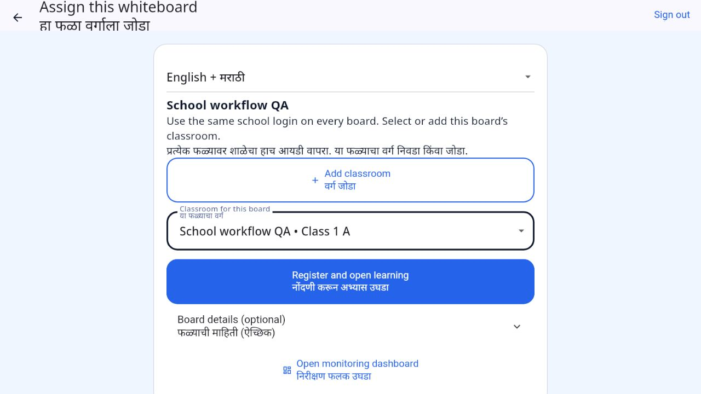

# One school login, multiple classrooms — 2 November 2026

## How to use it

1. The central administrator opens **Dashboard → Schools → Add school**.
2. Saving generates one School ID and a random password for that school. Copy/save the credentials from the one-time dialog.
3. The school uses those same credentials on the dashboard and classroom application.
4. On each smartboard, sign in, select an existing classroom or tap **Add classroom**, then **Register and open learning**. The board name is optional under **Board details** and defaults to the classroom name. Device IDs are also kept inside that optional section.
5. The school's dashboard shows only its own classrooms, connected boards and activity. Separate teacher, student and classroom passwords are not required.

For a school created before this update, the central administrator opens its details and chooses **Generate school login**. The school ID remains visible in school details; the password cannot be read back after the one-time dialog is dismissed. Existing password-reset tools remain available to the central administrator. Existing users and assignments are preserved.

## Implementation

- Schema migration 6 adds a unique school-to-account mapping. Each generated account has the existing `school_admin` role and exactly one school scope. Creation of the school, account and mapping is atomic.
- Generated passwords have 120 bits of randomness. The server stores the existing salted scrypt hash; it does not store a recoverable password. No initial password-change step is required for the generated random credential.
- A second generation request returns a conflict rather than creating duplicate accounts or silently replacing a password.
- The same school login supports independently authenticated board installations. Signing out one board does not sign out the school's other boards or dashboard.
- School users can create and manage their own classrooms and enroll boards without individual teacher assignments. Cross-school creation and enrollment are rejected by the API.
- The classroom app takes an unconnected school login directly to board setup. Mathematics opens after successful enrollment. The central super administrator retains unlinked learning access.
- School dashboard guidance presents classroom creation and the learning-app link. Separate teacher-account administration is omitted from the school sidebar; central administrator tools remain available.
- Activity charts describe active accounts and account activity. A shared school account is not presented as individual teacher attendance; classroom/board activity remains separate.
- All new interface instructions and labels support English, Marathi and combined modes. Existing language switching, lesson content and quiz behaviour are preserved.
- The admin-only dashboard demo preview remains unchanged and is unavailable to generated school accounts. No demo mode is added to the learning app.
- Existing signed offline classroom grants, HTTPS, school isolation and session-only quiz-score behaviour remain in place. Monitoring requires a network connection; offline learning follows the existing grant policy.

## Verification

- Flutter analysis: no issues.
- Flutter suite: 102 passed, one managed-configuration test skipped in the default run; the managed test passed separately.
- Backend API/transport suite: 31 passed.
- PostgreSQL API/isolation suite: 24 passed in disposable test schemas.
- School-specific widget coverage: generated credential acknowledgement, bilingual instructions, direct classroom creation, grade data, optional board name, enrollment and learning access without creating a teacher account.
- Backend coverage: single account per school, two independently connected boards, refresh, online monitoring, lesson events, independent logout, cross-school denial, demo denial, disabled-school sign-in denial, existing-school upgrade and password non-disclosure in dashboard responses.
- Browser workflow against isolated local PostgreSQL: school sign-in → Add classroom → Class 1 A → connect board → bilingual learning → Class 1 addition lesson. A separately authenticated monitoring request reported one online classroom, one active lesson and the actual G1-C10 lesson-start event.
- Release builds and public smoke checks are recorded in [verification evidence](validation/school-login-2026-11-02/).

No fictitious school, classroom or board was created in the production database for verification. These checks cover web and API workflows; physical Android smartboard and Windows acceptance were not repeated in this change.
