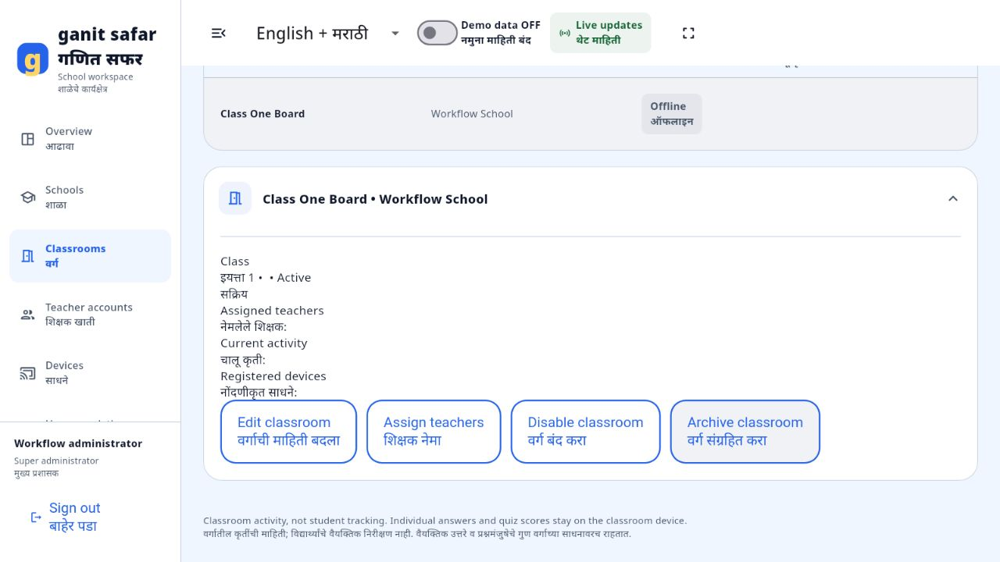

# Sign-in and school workflow fixes — 2 November 2026

Both deployed sites use the same live account database. The learning app has no demo page, demo-data switch, alternate demo login or sample board auto-enrollment. Its bundled learning content remains available. English, Marathi and combined language modes are preserved.

## Account controls

Refreshing `/sign-in` now respects a restored authenticated session instead of forcing the form to display again.

The classroom toolbar places language, sound, fullscreen and the account avatar on the right. The avatar provides account details, classroom connection, dashboard navigation for administrators and sign-out. Details show the account role, assigned classroom, connection and valid offline access deadline, when present.

An online administrator can open learning without enrolling a board. This creates no fake classroom activity and does not issue an offline classroom grant. Managed teachers still need an assigned, enrolled classroom and valid access.

## School and classroom workflow

- School name is required; an omitted school code is generated server-side.
- Newly created schools open with Add classroom and View classrooms actions.
- Creating a classroom inside a school preserves that school selection. Grade uses a 1–4 dropdown.
- Saving opens the new classroom in a school-scoped list with its monitoring details and administration actions.
- Navigation updates or clears the school filter as appropriate.
- Form controllers are owned by the dialog state until disposal, fixing the controller lifecycle errors during dialog transitions.
- Monitoring uses backend heartbeats and events. A new classroom remains offline until a board connects.

## Dashboard sample preview

Only an authenticated dashboard super administrator sees the sample-data switch. It opens an explicitly labelled, read-only view of the isolated sample schema using the same live admin session. It does not change identity, enroll a demo board or mutate live records. Other roles cannot access this endpoint, and the classroom deployment rejects it. Legacy `/api/presentation/*` routes return 404. Switching datasets clears filters and ignores late responses from the previous view.

## Validation

- Flutter analysis: no issues.
- Full Flutter suite: 100 passed; one managed-configuration test skipped in the default configuration and passed separately with its API define.
- Final focused account, portal, preview and management suite: 14 passed.
- Backend API, transport and sample-isolation suite: 29 passed.
- PostgreSQL API and isolation suite: 22 passed in disposable local schemas.
- Release web build completed with bundled rendering assets.
- Production browser reload: dashboard authentication resumes without re-entering credentials.
- Browser: school-name validation, school creation without a manual code, classroom creation inside that school, school-scoped monitoring, and stored school visibility after reloading and signing back in.
- Public checks and compiled JavaScript hash comparison: [release evidence](validation/2026-11-02/public-checks.json).

Browser-created workflow records exist only in an isolated local test schema. No production school or classroom data was fabricated for these checks.

This validates web and central-service workflows. It does not claim physical smartboard, Android APK or Windows build acceptance. Unlinked administrator learning does not generate monitored classroom activity. Older reports describe the superseded presentation system. GitHub commit and publication status are reported separately in the delivery message.
